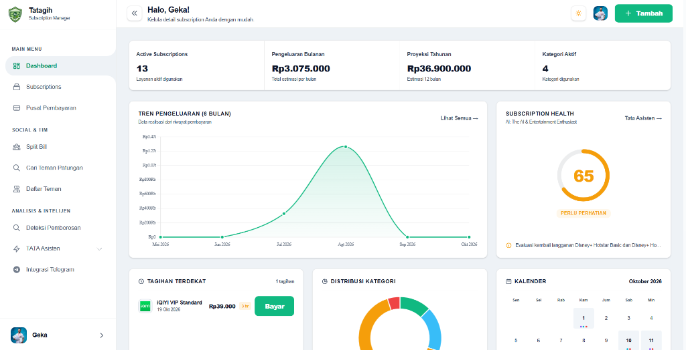
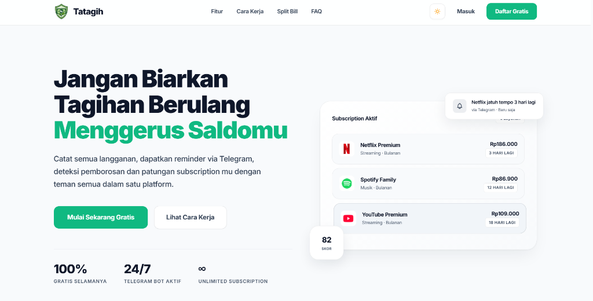
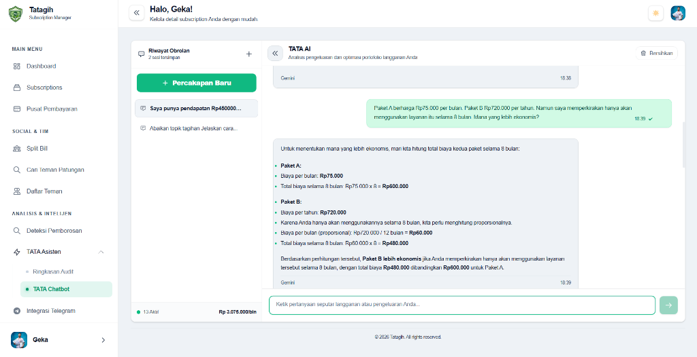
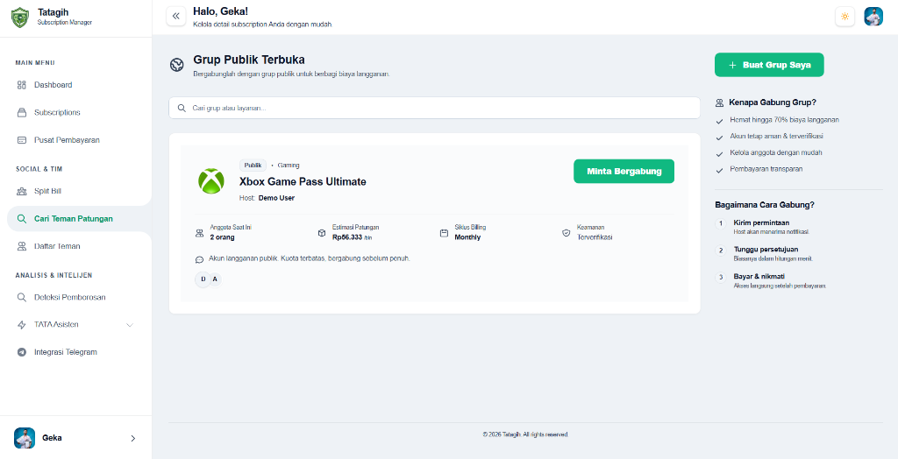
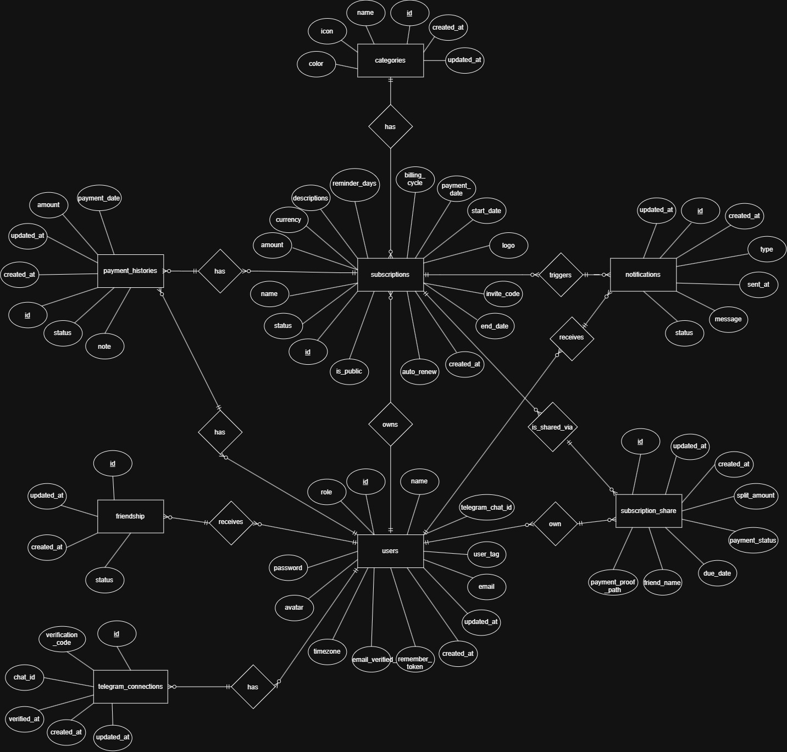

<div align="center">
  <h1>Tatagih</h1>
  <p><strong>Smart Subscription Manager & AI Financial Assistant</strong></p>
  
  [](https://laravel.com)
  [](https://www.php.net/)
  [](https://tailwindcss.com/)
  [](https://www.mysql.com/)
</div>

<hr>

## About the Project

**Tatagih** is an intelligent subscription management platform equipped with the Tata AI Assistant (powered by Google Gemini). Tatagih tracks recurring digital billing cycles, evaluates personal financial health scores, detects hidden wasteful expenses (vampire spending and overlapping subscriptions), manages shared group subscriptions (Family Plans) with fair cost splitting, and dispatches proactive reminder notifications directly to your Telegram messenger.

## Interface Previews

### Financial Dashboard & Due Date Calendar


### Landing Page & Value Proposition


### Tata AI Financial Assistant (Google Gemini)


### Group Subscription Sharing & Split Billing Verification


## Core Capabilities

- Group Subscription Sharing & Split Billing: Manage shared digital services (such as Family Plans) with friends or family. Fairly divide costs, upload payment receipts, and verify transaction statuses.
- Telegram Bot Proactive Notifications: Connect your profile with the official Telegram Bot. Receive automated schedule alerts before renewal deadlines (H-3 and H-1) via Laravel Scheduler and Queue workers.
- Financial Leakage & Overlap Detection:
  - Overlapping Subscriptions: Identifies redundant digital services that share identical functionalities (e.g., active subscriptions across Netflix, Disney+, and HBO Max concurrently).
  - Vampire Spending: Detects minor recurring micro-transactions that appear negligible on a monthly basis but represent significant cumulative financial leakage across multi-year horizons.
- Smart Service Templates & Plan Comparison: Register recurring expenses within seconds using pre-built templates for popular services. Compare tier pricing to identify the most cost-effective tier.
- Tata AI Assistant (Google Gemini): Evaluates spending habits, computes a comprehensive Financial Health Score (0 to 100), and generates contextual savings recommendations.
- Interactive Analytics & Secure Authentication: Data visualization powered by Chart.js (6-month expenditure curves and category distributions), backed by secure session authentication, role access control, and password reset flows.

## Technology Stack

- Backend Engine: Laravel 13.x, PHP 8.3+
- Frontend Architecture: Tailwind CSS, Vite, Laravel Blade Templates, Chart.js
- Database: MySQL / MariaDB (Relational schema with normalized relations)
- External Integrations: Telegram Bot API, Google Gemini API

## Database Architecture (Entity Relationship Diagram)

Click the diagram preview below to inspect the complete schema architecture:

[](./docs/ERD.jpg)

## System Requirements

- PHP >= 8.3 with extensions: `pdo_mysql`, `curl`, `mbstring`, `openssl`
- Composer (PHP Dependency Manager)
- Node.js (>= 18.x) & npm
- MySQL 5.7+ or MariaDB 10.4+

## Installation Guide

Follow the steps below to configure and run Tatagih in your local development environment:

### 1. Clone the Repository
```bash
git clone https://github.com/ANTARTICA1/Subscription-Guard.git
cd Subscription-Guard
```

### 2. Install PHP Dependencies
```bash
composer install
```

### 3. Install Frontend Dependencies & Compile Assets
```bash
npm install
npm run build
```

### 4. Configure Environment Variables
Duplicate `.env.example` into `.env`:
```bash
cp .env.example .env
```
*(On Windows Command Prompt, execute: `copy .env.example .env`)*

### 5. Generate Application Encryption Key
```bash
php artisan key:generate
```

### 6. Configure Database and Services
Create a new database in MySQL (e.g., `tatagih_db`). Open `.env` and specify your credentials:
```env
DB_CONNECTION=mysql
DB_HOST=127.0.0.1
DB_PORT=3306
DB_DATABASE=tatagih_db
DB_USERNAME=root
DB_PASSWORD=
```
*(Optional: Configure `TELEGRAM_BOT_TOKEN` and `GEMINI_API_KEY` inside `.env` to enable bot notifications and AI features).*

### 7. Run Database Migrations and Seeders
Execute database migrations and sample seeds:
```bash
php artisan migrate --seed
```
*The `--seed` flag automatically populates default administrative and regular user credentials along with sample data.*

**Default Credentials:**
- Standard User (Recommended for full feature evaluation): `user@tatagih.app` | Password: `password`
- Administrator: `admin@tatagih.app` | Password: `password`

### 8. Start the Local Server
Launch the local Laravel HTTP server:
```bash
php artisan serve
```

For scheduled reminder dispatches and asynchronous queue handling, launch workers in dedicated terminal tabs:
```bash
# Terminal Tab 1: Queue Worker
php artisan queue:work

# Terminal Tab 2: Scheduler Worker
php artisan schedule:work
```

## Evaluator Notes

- Primary Feature Scope: Core features (Tata AI Assistant, Financial Leakage Detector, and Subscription Sharing) are situated within the **Standard User** perspective. The Administrator interface serves as a management overview. It is recommended to authenticate using `user@tatagih.app` to evaluate end-user workflows.
- Email Testing: If Google SMTP app passwords are not configured, set `MAIL_MAILER=log` inside `.env`. Password reset tokens will be safely logged to `storage/logs/laravel.log`.

## Author

Anak Agung Ngurah Krisna Artha Wibawa ([ANTARTICA1](https://github.com/ANTARTICA1))

## License

This project is licensed under the MIT License.